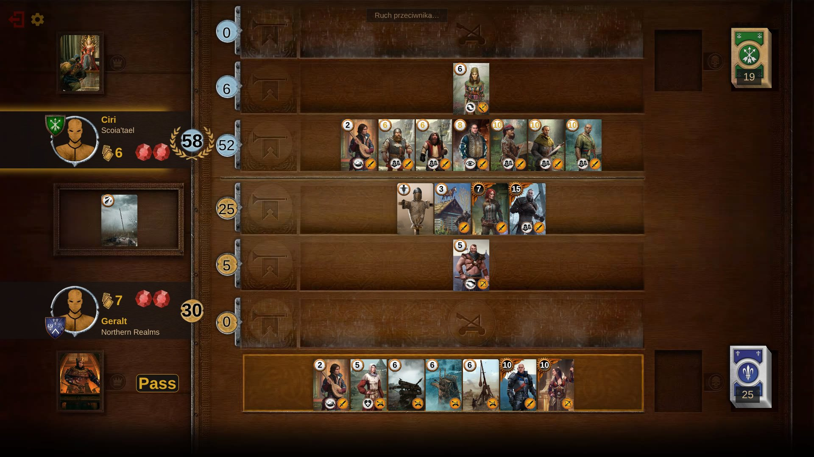
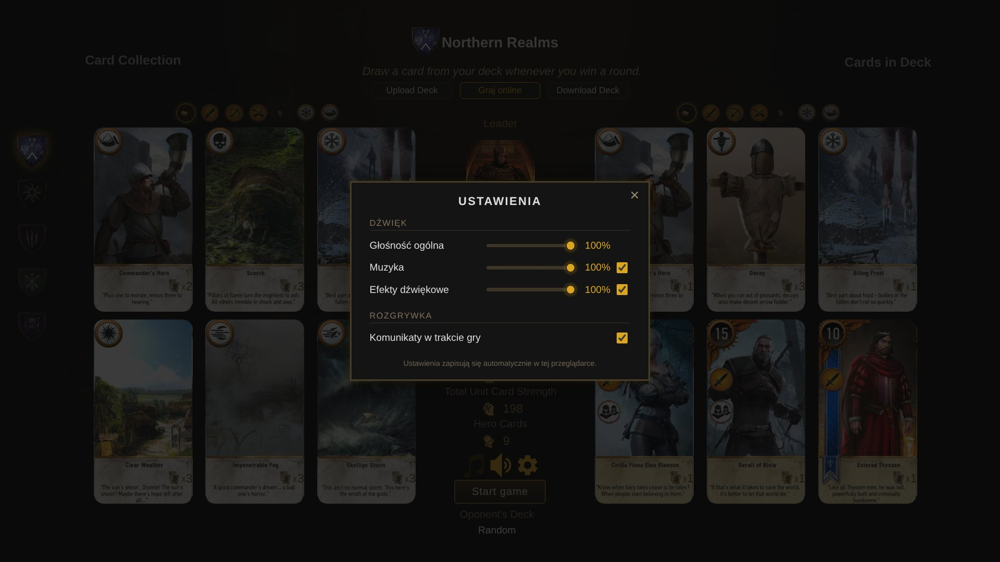
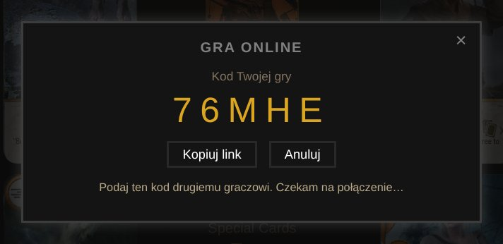
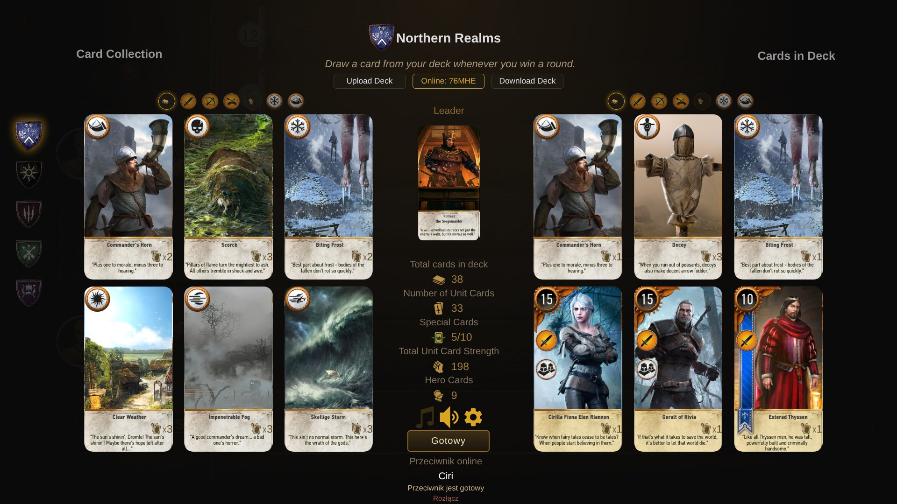

<div align="center">

# ⚔️ Gwent Classic · Online

**Klasyczny Gwint z Wiedźmina 3 w przeglądarce — teraz także 1 na 1 przez internet.**<br>
Utwórz grę, wyślij znajomemu kod i siadajcie do stołu. Bez instalacji, bez kont, bez serwera.

<br>

[](https://igit418.github.io/gwent-classic-multiplayer/)
[](#-gra-ze-znajomym)
[](#)


<br>



<sub><i>Partia online: na górze przeciwnik, na dole Ty. Napis „Ruch przeciwnika…” pokazuje, że gra czeka na jego decyzję. Zębatka w lewym górnym rogu otwiera ustawienia.</i></sub>

</div>

<br>

## ✨ Co tu znajdziesz

<table>
<tr>
<td width="50%" valign="top">

### 🌐 Gra online 1 na 1
Graj ze znajomym przez internet. Jeden gracz tworzy grę i dostaje 5-znakowy kod, drugi go wpisuje. Połączenie idzie bezpośrednio między przeglądarkami.

</td>
<td width="50%" valign="top">

### 🃏 Wszystkie karty z gry
Komplet kart z podstawki, **Serc z kamienia**, **Krwi i wina** oraz aktualizacji next-gen, łącznie z Płotką i talią Skellige. Nazwy, liczby kopii, zdolności i grafiki dowódców są sprawdzone z Wiedźminem 3.

</td>
</tr>
<tr>
<td valign="top">

### 🤖 Przeciwnik komputerowy
Nie masz z kim zagrać? Zmierz się z AI, które ocenia rękę, stół i cmentarze, zanim wykona ruch.

</td>
<td valign="top">

### 🛠️ Własne talie
Buduj talie w edytorze z filtrami kategorii, zapisuj je do pliku i wczytuj ponownie. Talia każdej frakcji zapamiętuje się w przeglądarce.

</td>
</tr>
<tr>
<td valign="top">

### 🔄 Partia przetrwa odświeżenie
Odświeżenie strony albo chwilowa utrata internetu nie kończy gry online. Partia sama się odtwarza, a przeciwnik czeka na Twój powrót do 3 minut.

</td>
<td valign="top">

### ⚙️ Ustawienia i muzyka
Osobne suwaki głośności ogólnej, muzyki i efektów oraz przełącznik komunikatów. Wszystko zapisuje się automatycznie.

</td>
</tr>
</table>

<br>

## 🃏 Edytor talii

<div align="center">

<sub><i>Edytor talii: po lewej tarcze frakcji, nad kolekcją i talią filtry kategorii, pośrodku dowódca i statystyki talii.</i></sub>
</div>

<br>

- **Frakcję zmieniasz jednym kliknięciem** w tarczę po lewej stronie.
- **Filtry kategorii** (rzędy, bohaterowie, pogoda, karty specjalne) działają osobno dla kolekcji i dla talii.
- **Dowódcę wybierasz** kliknięciem w jego kartę: przewiń listę i kliknij dwukrotnie wybranego dowódcę.
- Nad dowódcą jest rząd przycisków **Upload Deck**, **Graj online** i **Download Deck**: wczytanie talii z pliku, gra przez internet i zapis talii do pliku.
- Pod statystykami są szybkie przełączniki muzyki i dźwięku oraz **zębatka ustawień**.

### 🎴 Wybieranie kart z listy

Ta sama lista kart pojawia się przy wymianie kart na początku partii, wyborze dowódcy, wskrzeszaniu medykiem i innych wyborach:

- **przeciągnij** listę myszką albo palcem (lub użyj kółka myszy), żeby płynnie ją przewinąć,
- **kliknij** kartę z boku, żeby przesunąć ją na środek,
- **kliknij dwukrotnie** (albo stuknij dwa razy), żeby wybrać kartę, np. wymienić ją na początku partii.

### ⚙️ Ustawienia

<div align="center">

<br>
<sub><i>Panel ustawień otwierany zębatką: głośność ogólna, muzyka, efekty dźwiękowe i komunikaty w trakcie gry.</i></sub>
</div>

<br>

W trakcie partii przy przycisku wyjścia jest tylko mała zębatka, żeby przełączniki nie zasłaniały przycisku **Pas**. Muzyka startuje po pierwszym kliknięciu na stronie (tak wymagają przeglądarki) i słucha ustawień z panelu.

<br>

## 🎮 Gra ze znajomym

> [!TIP]
> Wystarczą **3 kroki**, a cała gra działa w przeglądarce, także na zwykłym laptopie.

| | Ty | Twój znajomy |
|:-:|---|---|
| **1** | W edytorze talii kliknij **Graj online** (środkowy przycisk nad dowódcą) → **Utwórz grę** | Otwórz tę samą stronę i kliknij **Graj online** |
| **2** | Wyślij mu kod (np. `K7M2Q`) albo link z **Kopiuj link** | Wpisz kod i kliknij **Dołącz** |
| **3** | Wybierz talię i kliknij **Gotowy** | Wybierz talię i kliknij **Gotowy** |

Gra startuje, gdy obaj jesteście gotowi. Zmiana talii albo frakcji po kliknięciu **Gotowy** anuluje gotowość. Po partii możecie od razu zagrać **rewanż** albo wrócić do zmiany talii bez rozłączania.

Jeśli w trakcie partii odświeżysz stronę albo stracisz na chwilę połączenie, gra sama wznowi partię. Przeciwnik zobaczy pasek z licznikiem i poczeka do 3 minut (może też zakończyć partię przyciskiem **Zakończ partię**).

<div align="center">

&nbsp;

<br>
<sub><i>Po lewej: kod gry do wysłania znajomemu. Po prawej: wybór talii, przycisk „Gotowy” i status przeciwnika pod nim.</i></sub>
</div>

<br>

## 📜 Zasady w pigułce

Wygrywa ten, kto zwycięży w **dwóch z trzech rund**. Rundę wygrywa gracz z większą liczbą punktów na stole.

- **Tura** to zagranie jednej karty albo użycie zdolności dowódcy.
- **Pas** kończy Twój udział w rundzie, a przeciwnik może dalej dokładać karty.
- **Karty specjalne** zmieniają pogodę, wzmacniają rzędy albo palą najsilniejsze jednostki.
- **Frakcja** ogranicza dostępne karty i daje unikalny bonus (np. Nilfgaard wygrywa remisy).

<details>
<summary><b>Pełne zasady (rozwiń)</b></summary>

<br>

**Karty i punkty.** Punkty zdobywasz, wykładając karty jednostek. Niektóre jednostki mają zdolności specjalne, oznaczone symbolem po lewej stronie karty. Kartę lub cały rząd możesz kliknąć, żeby obejrzeć efekty. Karty specjalne nakładają np. złą pogodę albo wzmacniają punkty.

**Tury.** W swojej turze zagrywasz jedną kartę, potem kolej przeciwnika, aż jeden z was spasuje. Drugi gracz może wtedy dokładać karty, dopóki też nie spasuje. Gdy obaj spasują, runda się kończy. Zamiast karty możesz też użyć zdolności dowódcy, klikając go, jeśli jest dostępna.

**Frakcje.** Wybrana frakcja wpływa na grę na trzy sposoby: ogranicza karty jednostek do tej frakcji (plus neutralne i specjalne), wyznacza dostępnych dowódców i ich zdolności oraz daje pasywny bonus frakcji, opisany na ekranie budowania talii. Mardroeme można dodać tylko do talii Skellige.

**Wezwanie (Muster).** Karta z tą zdolnością przywołuje na stół karty o tej samej nazwie z talii (nie z ręki), tak jak w Wiedźminie 3.

</details>

<br>

## 🔧 Jak działa tryb online

<details>
<summary><b>Dla ciekawych — technicznie (rozwiń)</b></summary>

<br>

- **Lockstep:** obie przeglądarki liczą tę samą symulację gry. Przez sieć lecą tylko decyzje graczy: jaka karta, do którego rzędu, pas, dowódca, wybory w okienkach.
- **Wspólna losowość:** tasowanie i losowe efekty korzystają z generatora z tym samym ziarnem, więc u obu graczy dzieje się dokładnie to samo.
- **Kontrola synchronizacji:** po każdej turze gry porównują skrót stanu. Gdyby kiedyś się rozjechały, pojawi się ostrzeżenie, a szczegóły trafią do konsoli (F12).
- **Peer-to-peer:** połączenie WebRTC przez [PeerJS](https://peerjs.com/). Publiczny serwer PeerJS tylko „przedstawia” sobie przeglądarki, a sama gra może leżeć na dowolnym hostingu statycznym, np. GitHub Pages.

Szczegóły, testowanie lokalne i hosting opisuje [ONLINE.md](ONLINE.md).

</details>

> [!NOTE]
> W bardzo restrykcyjnych sieciach (niektóre firmowe lub komórkowe) bezpośrednie połączenie może się nie udać. Pomaga wtedy serwer TURN, który przekazuje ruch między graczami.

### 🛰️ Serwer TURN

Ustawienia STUN/TURN są w pliku [`net-config.js`](net-config.js). Najprościej użyć darmowego [Metered Open Relay](https://www.metered.ca/tools/openrelay/) (20 GB miesięcznie, a partia Gwinta to kilkadziesiąt KB):

1. Załóż konto na [dashboard.metered.ca](https://dashboard.metered.ca/signup?tool=turnserver) i utwórz klucz API do poświadczeń (credential API key).
2. W `net-config.js` wpisz:
   ```js
   window.GWENT_NET_CONFIG = {
   	credentialsUrl: "https://<appname>.metered.live/api/v1/turn/credentials?apiKey=<klucz API>"
   };
   ```
3. Sprawdź, otwierając grę u obu graczy z dopiskiem `?relay` (połączenie tylko przez TURN).

Można też podać stały adres i hasło (`turnUrls`, `turnUsername`, `turnCredential`) albo ustawić wszystko zmiennymi repozytorium przez GitHub Actions. Szczegóły w [ONLINE.md](ONLINE.md#serwer-turn-połączenie-przez-trudne-sieci).

<br>

## 🚀 Uruchomienie u siebie

```bash
git clone https://github.com/igit418/gwent-classic-multiplayer.git
cd gwent-classic-multiplayer
python -m http.server 8000
```

Następnie otwórz `http://localhost:8000`. Do testów online na jednym komputerze dodaj do adresu `?net=local` i otwórz grę w dwóch kartach przeglądarki.

<br>

## 🙏 Podziękowania i licencja

- Oryginalna przeglądarkowa wersja gry: **[Arun Sundaram — gwent-classic](https://github.com/asundr/gwent-classic)**
- Efekty dźwiękowe: **[RandomPianist](https://github.com/RandomPianist/gwent-classic-v3.1)**
- Tryb online: rozwinięcie projektu w tym repozytorium

Kod udostępniany jest na licencji **MIT z warunkiem „Commons Clause”**, który zabrania sprzedaży oprogramowania. Pełny tekst jest w pliku [LICENSE](LICENSE).

<sub>Gwint, Wiedźmin oraz grafiki kart należą do CD PROJEKT RED. To niekomercyjny projekt fanowski, niezwiązany z CD PROJEKT RED.</sub>

<br>

<details>
<summary>🇬🇧 <b>English</b></summary>

<br>

A browser remake of the original Gwent minigame from *The Witcher 3: Wild Hunt*, including all DLC cards (names, copy counts, abilities and leader art checked against The Witcher 3), **now with online 1v1 multiplayer**. Click **Graj online** (Play online) above the leader in the deck builder, create a game and share the 5-character code with a friend. Both browsers run the same deterministic simulation and exchange only player decisions over a peer-to-peer WebRTC connection, so no game server is needed. An online match survives a page reload or a short disconnect. Cards in lists (redraw, leader picker, medic) scroll by dragging and are chosen with a double click; the gear button opens volume and sound settings.

**[▶ Play now](https://igit418.github.io/gwent-classic-multiplayer/)**. Based on [asundr/gwent-classic](https://github.com/asundr/gwent-classic) (MIT + Commons Clause).

</details>
